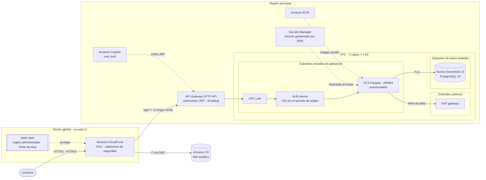
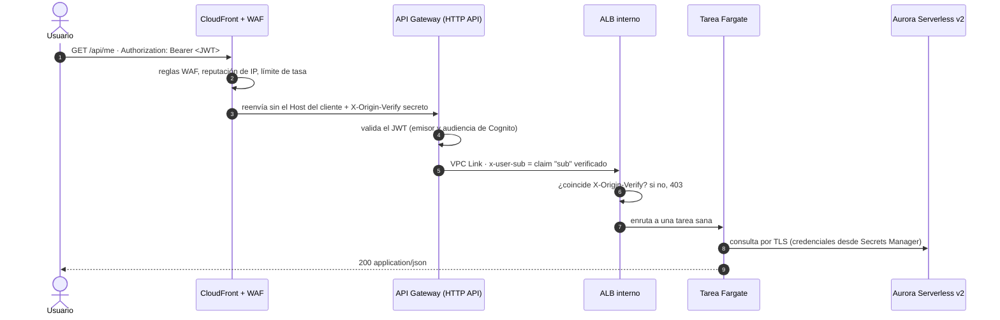
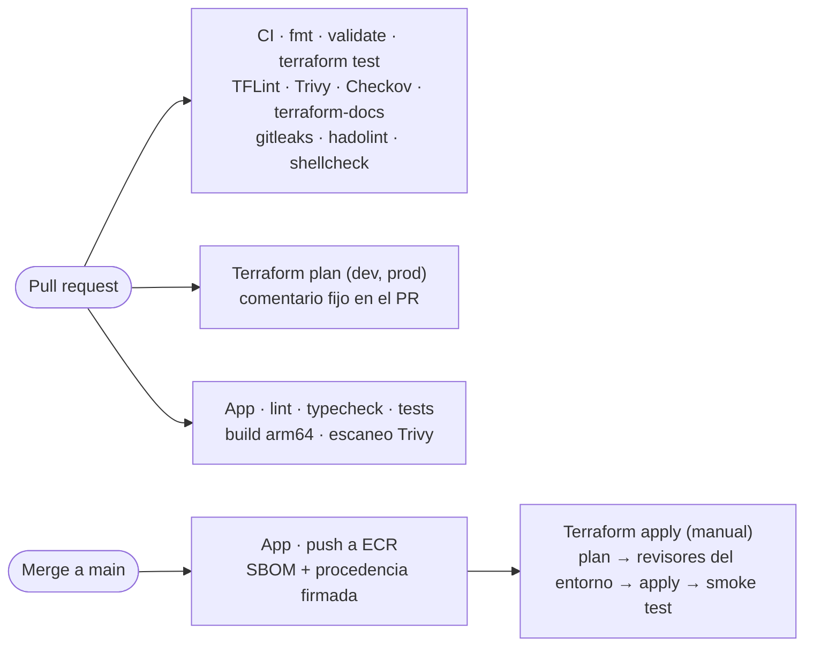

# AWS Reservations Platform — Infraestructura como Código

[](https://github.com/vfernandezg-dev/aws-reservations-platform/actions/workflows/ci.yml)
[](https://github.com/vfernandezg-dev/aws-reservations-platform/actions/workflows/app.yml)


-2E7D32)
[](LICENSE)

> 🇬🇧 [Read in English](README.md)

Plataforma AWS multi-entorno, lista para producción, para un **negocio de reservas de eventos y locales**
(cotizaciones, reservas, pagos, turnos de personal), escrita en **Terraform** con controles de seguridad,
confiabilidad y costos integrados, y desplegada mediante un pipeline de CI/CD totalmente automatizado.

**Aspectos destacados**

- 🌐 **Del borde serverless a un núcleo privado**: CloudFront + WAF → API Gateway HTTP API (JWT de Cognito) → VPC Link → ALB *interno* → ECS Fargate (Graviton) → Aurora Serverless v2 (PostgreSQL 18).
- 🔐 **Defensa en profundidad**: nada dentro de la VPC está expuesto a internet, security groups encadenados por referencia, cabecera secreta de origen contra el bypass del WAF, llaves KMS administradas por el cliente, secretos gestionados por RDS (ninguna contraseña en Terraform) y TLS en todo tráfico que sale de la VPC.
- 💸 **Costos bajo control desde el diseño**: Aurora escala a **cero** cuando está inactiva, Fargate Spot + ARM64, un solo NAT fuera de producción y dimensionamiento por entorno en los `tfvars`.
- 🧪 **Probado y escaneado**: 24 casos de `terraform test` con proveedor simulado (mock), TFLint, Trivy, Checkov (**0 fallos** con la configuración de producción y cada excepción justificada en el código), gitleaks, hadolint y shellcheck.
- 🚀 **Entrega estilo GitOps**: GitHub Actions con OIDC (sin llaves de larga duración), planes como comentario en cada PR, despliegues con aprobación por entorno que aplican exactamente el plan revisado, y procedencia de imagen firmada + SBOM.

---

## Contenido

1. [Arquitectura](#arquitectura)
2. [Seguridad por diseño](#seguridad-por-diseño)
3. [Confiabilidad y escalabilidad](#confiabilidad-y-escalabilidad)
4. [Entornos](#entornos)
5. [Costos](#costos)
6. [Estructura del repositorio](#estructura-del-repositorio)
7. [Primeros pasos](#primeros-pasos)
8. [CI/CD](#cicd)
9. [Controles de calidad y pruebas](#controles-de-calidad-y-pruebas)
10. [Buenas prácticas de IaC aplicadas](#buenas-prácticas-de-iac-aplicadas)
11. [Decisiones de diseño](#decisiones-de-diseño)
12. [Hoja de ruta](#hoja-de-ruta)
13. [Historia del proyecto](#historia-del-proyecto)

---

## Arquitectura



### Flujo de una petición



El contenido estático (`/*`) se sirve desde S3 mediante **Origin Access Control**; solo la distribución puede leer el bucket.

### Distribución de red

| Capa | Subredes (2 AZ) | Contiene | Ruta por defecto |
|---|---|---|---|
| Pública | `10.x.0.0/24`, `10.x.1.0/24` | Solo NAT gateways | Internet gateway |
| Aplicación (privada) | `10.x.10.0/24`, `10.x.11.0/24` | ENIs del VPC Link, ALB interno, tareas Fargate, endpoints de interfaz | NAT gateway (misma AZ) |
| Datos (aislada) | `10.x.20.0/24`, `10.x.21.0/24` | Instancias de Aurora | **ninguna** |

Los security groups se encadenan por referencia: `VPC Link → ALB:80 → tareas:8080 → Aurora:5432`. Ninguna regla de entrada usa un CIDR.

### Servicios de AWS

| Servicio | Rol | Configuración clave |
|---|---|---|
| CloudFront | Único punto de entrada público | Políticas administradas de caché/origen/cabeceras de seguridad, HTTP/3, logging v2 |
| AWS WAF | Protección en el borde | Reputación de IP, core rule set, known bad inputs (Log4Shell), SQLi, límite por IP, logs con campos ocultos |
| S3 | Sitio estático, logs | Privado, OAC, cifrado, versionado, ciclo de vida, políticas solo-TLS |
| API Gateway (HTTP API) | API pública, autenticación | Autorizador JWT de Cognito, throttling, logs de acceso JSON, integración privada |
| Cognito | Identidad | Plan Essentials, Managed Login v2, MFA TOTP, solo SRP + code flow (PKCE) |
| Elastic Load Balancing | Enrutamiento privado | ALB interno, regla de acceso por cabecera, descarte de cabeceras inválidas |
| ECS sobre Fargate | Cómputo | ARM64, imagen distroless sin root, sistema de archivos de solo lectura, circuit breaker, target tracking |
| Aurora Serverless v2 | Base de datos | PostgreSQL 18, 0–8 ACU, réplica Multi-AZ en prod, auditoría de conexiones/DDL, PITR |
| Secrets Manager | Credenciales | Contraseña maestra generada y rotada por RDS, inyectada por ECS |
| KMS | Cifrado | Llaves administradas por el cliente (con rotación) para Aurora, secretos, logs, SNS y el state |
| ECR | Imágenes | Tags inmutables, escaneo al subir, política de ciclo de vida |
| CloudWatch / SNS | Observabilidad | Alarmas en cada capa, dashboard, Container Insights, tópicos cifrados |
| VPC | Redes | Subredes de 3 capas, Flow Logs, endpoint gateway de S3, endpoints de interfaz opcionales |

Cada módulo tiene su propio README en [`infrastructure/modules`](infrastructure/modules); el recorrido detallado está en [`docs/architecture.md`](docs/architecture.md).

---

## Seguridad por diseño

| Capa | Controles |
|---|---|
| **Borde** | Grupos de reglas administradas de WAF + límite de tasa, clientes solo HTTPS (TLS 1.2+), cabeceras de seguridad administradas por AWS (HSTS, X-Frame-Options, …) |
| **Identidad** | JWT de Cognito validado por API Gateway; las rutas anónimas eliminan las cabeceras `x-user-*` y las protegidas las sobrescriben con los claims verificados (sin suplantación) |
| **Protección del origen** | CloudFront añade la cabecera secreta `X-Origin-Verify`; sin ella el ALB interno responde 403, por lo que llamar directamente a la URL `execute-api` no permite saltarse el WAF |
| **Red** | Sin IPs públicas en las cargas de trabajo, ALB interno, subredes de datos sin ruta por defecto, reglas SG→SG, SG por defecto bloqueado, VPC Flow Logs |
| **Cómputo** | Imagen distroless sin root, sistema de archivos raíz de solo lectura, roles de tarea/ejecución con mínimo privilegio, escaneo de imágenes en CI y ECR |
| **Datos** | Aurora cifrada con una CMK, TLS obligatorio (`rds.force_ssl`), autenticación IAM habilitada, protección contra borrado, backups + PITR, auditoría de conexiones y DDL |
| **Secretos** | Ningún secreto de base de datos en código, variables ni state: RDS gestiona la contraseña y ECS la inyecta en tiempo de ejecución |
| **Cadena de suministro** | Actions fijadas por SHA de commit, Dependabot, SBOM + procedencia de build firmada, imágenes base fijadas por digest |
| **Entrega** | Roles OIDC acotados por repositorio/rama/entorno, rol de plan de solo lectura, revisores por entorno antes de aplicar, state cifrado con bloqueo |

Las excepciones de los escáneres nunca se esconden en una configuración global: cada una está junto
al recurso como `#checkov:skip=<id>:<motivo>` o `# trivy:ignore:<id> <motivo>`.

---

## Confiabilidad y escalabilidad

- **Multi-AZ en todo**: subredes, NAT (prod), ALB, tareas Fargate con rebalanceo entre AZ, escritor + lector de Aurora en AZ distintas (prod) con failover automático.
- **Auto-reparación**: los health checks del ALB y del contenedor reemplazan tareas no sanas; los despliegues usan circuit breaker con rollback automático.
- **Elasticidad**: target tracking por CPU y por peticiones por tarea; Aurora Serverless v2 escala en pasos de 0.5 ACU y se pausa cuando no se usa (dev/staging).
- **Observabilidad**: alarmas de 5xx en cada salto, targets no sanos, saturación y deadlocks, picos de bloqueos del WAF; dashboard por entorno; bloques `check` verifican los endpoints públicos tras cada apply.
- **Protección de datos**: backups automáticos (1–14 días), recuperación a un punto en el tiempo, snapshot final con nombre único y protección contra borrado en producción.

---

## Entornos

Un único módulo raíz, un archivo de state por entorno y diferencias solo en [`infrastructure/environments`](infrastructure/environments).

| Parámetro | dev | staging | prod |
|---|---|---|---|
| NAT gateways | 1 compartido | 1 compartido | 1 por AZ |
| Endpoints de interfaz | – | – | ECR, Logs, Secrets Manager |
| Fargate | 1–2 tareas, **Spot** | 1–3 tareas, Spot | 2–6 tareas, bajo demanda |
| Aurora | 0–2 ACU (**se pausa**), 1 instancia | 0–4 ACU, 1 instancia | 0.5–8 ACU, escritor + lector |
| Autenticación en `/api/*` | desactivada (exploración libre) | JWT de Cognito + Managed Login | JWT de Cognito + Managed Login |
| Protección contra borrado | no | no | **sí** |
| Retención de logs | 7 días | 14 días | 365 días |
| Enhanced monitoring / PI | – | – | 60 s / sí |

---

## Costos

> **Nota:** estas cifras son una **referencia aproximada, exclusivamente para este proyecto de
> portafolio**; no son una cotización ni un compromiso. Usan precios públicos bajo demanda en
> `us-east-1`, no incluyen tráfico, peticiones ni volumen de logs, y variarán según el uso real y los
> cambios de precios de AWS. Ejecuta `make cost` (Infracost) para una estimación detallada.

| Componente | dev | prod |
|---|---|---|
| NAT gateway(s) con IPv4 pública | ~$36 | ~$73 |
| ALB interno | ~$16 | ~$16 |
| AWS WAF (Web ACL + 5 reglas) | ~$10 | ~$10 |
| Fargate ARM64 | ~$2 (Spot, 0.25 vCPU) | ~$29 (2 × 0.5 vCPU) |
| Aurora Serverless v2 | solo almacenamiento mientras está pausada | ~$88 (2 × 0.5 ACU mín.) |
| Endpoints de interfaz | – | ~$58 |
| KMS, dashboard, alarmas, secreto | ~$7 | ~$7 |
| **Total (aprox.)** | **~$70 / mes** | **~$280 / mes** |

Palancas de ahorro ya aplicadas: base de datos que escala a cero, Spot, Graviton (~20% más barato que x86),
un solo NAT fuera de producción, retención corta de logs en dev y `make destroy` para entornos efímeros.

---

## Estructura del repositorio

```text
.
├── app/                     # API de ejemplo (TypeScript, Fastify, Node.js 26) + migraciones SQL + Dockerfile
├── bootstrap/               # Una sola vez: bucket de state (KMS), roles OIDC de GitHub, repositorio ECR
├── infrastructure/          # Módulo raíz (uno por entorno vía tfvars)
│   ├── environments/        # dev / staging / prod .tfvars + configuración del backend
│   ├── modules/             # 13 módulos enfocados, cada uno con README (terraform-docs)
│   └── tests/               # Suites de terraform test (proveedor AWS simulado)
├── scripts/                 # build-push, db-migrate (tarea Fargate puntual), smoke-test
├── ci-cd/jenkins/           # Pipeline alternativo: Jenkinsfile + imagen del controlador con JCasC
├── docs/                    # Arquitectura en detalle, ADRs, runbooks
├── .github/                 # Workflows, Dependabot, plantilla de PR, CODEOWNERS
├── Makefile                 # Punto de entrada único para todas las tareas
└── .pre-commit-config.yaml  # Los mismos controles que CI, antes de cada commit
```

| Módulo | Propósito |
|---|---|
| [network](infrastructure/modules/network) | VPC de 3 capas, NAT, endpoints, Flow Logs |
| [security](infrastructure/modules/security) | Security groups encadenados |
| [kms](infrastructure/modules/kms) | Llaves administradas por el cliente y sus políticas |
| [logging](infrastructure/modules/logging) | Bucket central de logs |
| [storage](infrastructure/modules/storage) | Bucket privado del sitio estático |
| [cdn](infrastructure/modules/cdn) | CloudFront, OAC, secreto de origen, logging v2 |
| [waf](infrastructure/modules/waf) | Web ACL de WAFv2 y sus logs |
| [auth](infrastructure/modules/auth) | User pool de Cognito y cliente SPA |
| [api](infrastructure/modules/api) | HTTP API, autorizador JWT, VPC Link |
| [alb](infrastructure/modules/alb) | ALB interno con verificación de origen |
| [ecs](infrastructure/modules/ecs) | Clúster Fargate, servicio, escalado, tarea de migraciones |
| [aurora](infrastructure/modules/aurora) | Aurora Serverless v2 PostgreSQL 18 |
| [monitoring](infrastructure/modules/monitoring) | Alarmas, SNS, dashboard |

---

## Primeros pasos

**Requisitos**: Terraform ≥ 1.10 (CI usa 1.17), AWS CLI v2, Docker con Buildx, GNU Make y una
cuenta de AWS con acceso de administrador para el bootstrap inicial. Node.js 26 solo para desarrollar la app.

```bash
# 1. Base de una sola vez: bucket de state, roles OIDC, ECR
cd bootstrap && cp terraform.tfvars.example terraform.tfvars   # define github_repository
terraform init && terraform apply && cd ..

# 2. Construir la imagen arm64 y publicarla (tag = commit actual)
make image

# 3. Desplegar un entorno
make plan  ENV=dev
make apply ENV=dev

# 4. Crear el esquema (tarea Fargate puntual dentro de la VPC) y verificar de punta a punta
make migrate ENV=dev
make smoke   ENV=dev       # pruebas funcionales + de seguridad (WAF, JWT, secreto de origen)

# 5. Destruir al terminar
make destroy ENV=dev
```

`make help` lista todos los objetivos; `make check` ejecuta todos los controles de calidad en local sin credenciales de AWS.
Runbooks paso a paso: [despliegue](docs/runbooks/deploy.md) · [migraciones](docs/runbooks/db-migrate.md) · [destrucción](docs/runbooks/destroy.md) · [solución de problemas](docs/runbooks/troubleshooting.md).

---

## CI/CD



| Workflow | Disparador | Qué hace |
|---|---|---|
| [`ci.yml`](.github/workflows/ci.yml) | PR, push a main | Todos los controles estáticos; SARIF a GitHub code scanning; no necesita acceso a AWS |
| [`app.yml`](.github/workflows/app.yml) | Cambios en `app/` | Pruebas, build arm64, escaneo; en main publica en ECR con SBOM y atestación |
| [`terraform-plan.yml`](.github/workflows/terraform-plan.yml) | PR que toca `infrastructure/` | Rol OIDC de solo lectura, plan por entorno, comentario en el PR |
| [`terraform-apply.yml`](.github/workflows/terraform-apply.yml) | Manual | Plan → aprobación del GitHub Environment → aplica el plan guardado → smoke test; destroy exige confirmación escrita |

El acceso a AWS usa roles **OIDC de GitHub** creados por [`bootstrap`](bootstrap): variables del repositorio
`AWS_REGION`, `TF_STATE_BUCKET`, `AWS_PLAN_ROLE_ARN`, `AWS_APPLY_ROLE_ARN`, `AWS_ECR_PUSH_ROLE_ARN` y
`ECR_REPOSITORY` (las imprime `terraform output github_actions_variables`). Los workflows que necesitan AWS
se omiten hasta que existan, así los forks quedan en verde.

Una alternativa en **Jenkins** con los mismos controles está en [`ci-cd/jenkins`](ci-cd/jenkins): un pipeline
parametrizado y una imagen de controlador configurada completamente como código (JCasC + Job DSL).

---

## Controles de calidad y pruebas

| Herramienta | Qué verifica | Dónde corre |
|---|---|---|
| `terraform fmt` / `validate` | Formato, sintaxis, tipos, validaciones entre variables | pre-commit, CI, Jenkins |
| `terraform test` | 24 pruebas unitarias con proveedor AWS simulado (subredes, estrategia NAT, encadenamiento de SG, rutas JWT, eliminación de cabeceras, tareas ARM64/solo lectura, HA y escalado a cero de Aurora, invariantes de WAF/CloudFront, validación de entradas) | CI, Jenkins |
| TFLint + ruleset AWS | Errores específicos del proveedor, nombres, declaraciones sin uso o sin documentar | pre-commit, CI, Jenkins |
| Trivy | Malas configuraciones de IaC (SARIF → code scanning) y CVEs de la imagen | CI, Jenkins |
| Checkov | ~280 políticas con la configuración de producción, 0 fallos | CI |
| terraform-docs | READMEs de módulos sincronizados con el código | pre-commit, CI |
| gitleaks | Secretos en todo el historial de git | pre-commit, CI |
| hadolint / shellcheck / actionlint | Dockerfiles, scripts y workflows | pre-commit, CI |
| Vitest + ESLint (estricto, con tipos) | Comportamiento y calidad del código de la app | CI |
| Bloques `check` + `smoke-test.sh` | Endpoints en vivo y controles de seguridad tras cada despliegue | Terraform, CD |

---

## Buenas prácticas de IaC aplicadas

- [x] State remoto en S3 con **bloqueo nativo**, versionado y llave KMS dedicada; un state por entorno
- [x] Módulos pequeños y de propósito único con variables tipadas, documentadas y **validadas**
- [x] Un módulo raíz + `tfvars` por entorno (sin entornos copiados y pegados)
- [x] `default_tags` para un etiquetado consistente (Project, Environment, Owner, CostCenter, Repository)
- [x] Sin IDs/AMIs/ARNs codificados a mano: data sources, búsqueda de políticas administradas, nombres deterministas
- [x] `for_each` con claves estables en lugar de `count` sobre listas
- [x] Sin secretos de credenciales en código ni en el state; valores `sensitive` donde un secreto es inevitable
- [x] Versiones de proveedores y herramientas fijadas; lock file para todas las plataformas; Dependabot para actualizaciones
- [x] Escaneo de políticas como código con excepciones justificadas y revisables
- [x] Pruebas unitarias nativas y bloques `check` posteriores al apply
- [x] Planes revisados antes de aplicar; se aplica exactamente el plan guardado
- [x] Credenciales de CI de corta duración y mínimo privilegio (OIDC)
- [x] Todo reproducible desde el `Makefile`; documentación generada desde el código

---

## Decisiones de diseño

Registros de decisiones de arquitectura (ADR, en inglés) en [`docs/adr`](docs/adr):

1. [State remoto en S3 con bloqueo nativo](docs/adr/0001-remote-state-s3-native-locking.md)
2. [Un módulo raíz, un tfvars por entorno](docs/adr/0002-single-root-module-per-environment-tfvars.md)
3. [HTTP API + VPC Link + ALB interno](docs/adr/0003-http-api-vpc-link-internal-alb.md)
4. [ECS Fargate en Graviton en lugar de EC2](docs/adr/0004-ecs-fargate-arm64.md)
5. [Aurora Serverless v2 PostgreSQL con credenciales gestionadas por RDS](docs/adr/0005-aurora-serverless-v2-postgresql.md)
6. [OIDC de GitHub en lugar de llaves de acceso estáticas](docs/adr/0006-github-oidc-ci-credentials.md)

---

## Hoja de ruta

- Dominio propio (Route 53 + ACM) y evaluación de CloudFront VPC origins
- Usuario de base de datos dedicado y de mínimo privilegio con autenticación IAM para la app (la app de ejemplo usa el secreto maestro gestionado)
- Trazas con OpenTelemetry (ADOT) y alarmas basadas en SLOs
- Plan de AWS Backup con copias entre cuentas; DR multi-región para el sitio estático y la base de datos
- Línea base de organización (GuardDuty, Security Hub, CloudTrail Lake) en un stack de cuenta separado

---

## Historia del proyecto

Este repositorio nació en 2025 como un **proyecto universitario en equipo** ("Villa Alfredo", curso de
Infraestructura como Código): un primer despliegue en Terraform de un sistema de reservas con EC2, un balanceador
público, API Gateway REST y RDS MySQL, además de pipelines en Jenkins.

La versión actual es mi **rediseño y modernización completos** de ese trabajo. Cambios principales:

| Área | Proyecto original | Esta versión |
|---|---|---|
| State y secretos | State local y `tfvars` con la contraseña de la base de datos subidos a git | State remoto cifrado con bloqueo; contraseña gestionada por RDS, nada secreto en git |
| Cómputo | 2 EC2 fijas + ASG sirviendo una página PHP de ejemplo | ECS Fargate ARM64, contenedor distroless, autoescalado, circuit breaker |
| API y autenticación | API REST con un autorizador que nunca se asoció; ALB público | HTTP API con JWT de Cognito, VPC Link privado, ALB interno con secreto de origen |
| Base de datos | RDS MySQL 8.0 (hoy en Extended Support de pago) | Aurora Serverless v2 PostgreSQL 18 con escalado a cero; esquema migrado desde MySQL |
| Borde | Políticas de bucket en conflicto, configuración KMS que bloqueaba OAC, cabecera Host que rompía la API | OAC, políticas administradas de CloudFront, logging v2, WAF con logs correctos |
| Calidad | Sin linting ni pruebas, 62 controles de Checkov fallidos | 24 pruebas de Terraform, TFLint, Trivy, Checkov con 0 fallos (prod), documentación generada |
| Entrega | Pipelines de Jenkins con copias del state y `state rm` como respaldo | GitHub Actions con OIDC, planes en PR, despliegues con aprobación, procedencia de imágenes; Jenkins ligero y como código |

Crédito al equipo original por el dominio de negocio y el modelo inicial de base de datos, que se migró
a PostgreSQL (y se corrigió) como las migraciones de [`app/migrations`](app/migrations).

## Licencia

[MIT](LICENSE)
