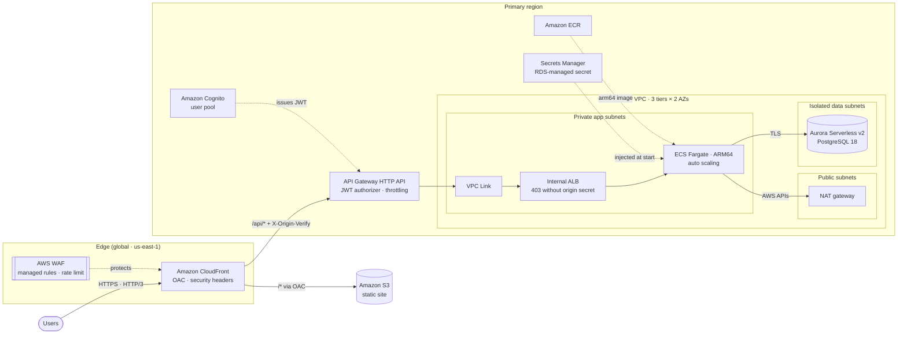
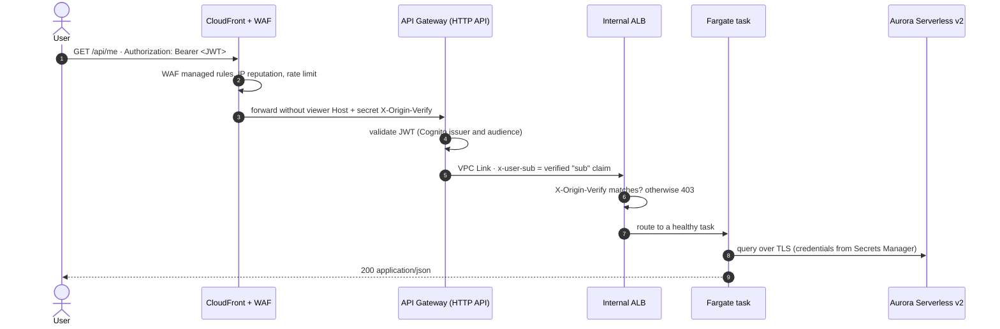
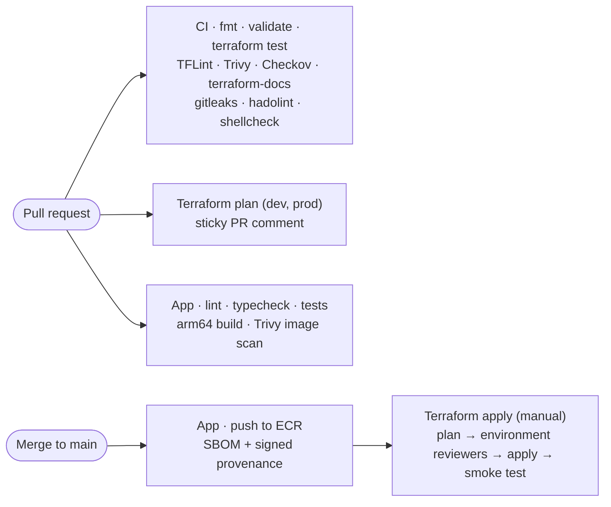

# AWS Reservations Platform — Infrastructure as Code

[](https://github.com/vfernandezg-dev/aws-reservations-platform/actions/workflows/ci.yml)
[](https://github.com/vfernandezg-dev/aws-reservations-platform/actions/workflows/app.yml)


-2E7D32)
[](LICENSE)

> 🇪🇸 [Leer en español](README.es.md)

Production-grade, multi-environment AWS platform for an **event & venue reservations business**
(quotations, reservations, payments, staff scheduling), written in **Terraform** with security,
reliability and cost controls built in, and shipped through a fully automated CI/CD pipeline.

**Highlights**

- 🌐 **Serverless edge to private core**: CloudFront + WAF → API Gateway HTTP API (Cognito JWT) → VPC Link → *internal* ALB → ECS Fargate (Graviton) → Aurora Serverless v2 (PostgreSQL 18).
- 🔐 **Defense in depth**: nothing in the VPC is internet-facing, SG-to-SG chaining, origin-secret header against WAF bypass, KMS CMKs, RDS-managed secrets (no password in Terraform), TLS everywhere it leaves the VPC.
- 💸 **Cost-aware by design**: Aurora scales to **zero** when idle, Fargate Spot + ARM64, single NAT in non-prod, per-environment sizing in `tfvars`.
- 🧪 **Tested & scanned**: 24 `terraform test` cases with a mocked provider, TFLint, Trivy, Checkov (**0 failures** on production settings, every exception justified inline), gitleaks, hadolint, shellcheck.
- 🚀 **GitOps-style delivery**: GitHub Actions with OIDC (no long-lived keys), PR plans as comments, environment-gated applies of the exact reviewed plan, signed image provenance + SBOM.

---

## Table of contents

1. [Architecture](#architecture)
2. [Security by design](#security-by-design)
3. [Reliability and scalability](#reliability-and-scalability)
4. [Environments](#environments)
5. [Cost](#cost)
6. [Repository structure](#repository-structure)
7. [Getting started](#getting-started)
8. [CI/CD](#cicd)
9. [Quality gates and testing](#quality-gates-and-testing)
10. [IaC best practices applied](#iac-best-practices-applied)
11. [Design decisions](#design-decisions)
12. [Roadmap](#roadmap)
13. [Project history](#project-history)

---

## Architecture



### Request flow



Static content (`/*`) is served from S3 through **Origin Access Control**; only the distribution can read the bucket.

### Network layout

| Tier | Subnets (2 AZs) | Contains | Default route |
|---|---|---|---|
| Public | `10.x.0.0/24`, `10.x.1.0/24` | NAT gateways only | Internet gateway |
| App (private) | `10.x.10.0/24`, `10.x.11.0/24` | VPC Link ENIs, internal ALB, Fargate tasks, interface endpoints | NAT gateway (same AZ) |
| Data (isolated) | `10.x.20.0/24`, `10.x.21.0/24` | Aurora instances | **none** |

Security groups are chained by reference: `VPC Link → ALB:80 → tasks:8080 → Aurora:5432`. No ingress rule uses a CIDR.

### AWS services

| Service | Role | Key configuration |
|---|---|---|
| CloudFront | Single public entry point | AWS managed cache/origin/security-headers policies, HTTP/3, logging v2 |
| AWS WAF | Edge protection | IP reputation, core rule set, known bad inputs (Log4Shell), SQLi, per-IP rate limit, redacted logs |
| S3 | Static site, logs | Private, OAC, SSE, versioning, lifecycle, TLS-only policies |
| API Gateway (HTTP API) | Public API, authN | Cognito JWT authorizer, throttling, JSON access logs, private integration |
| Cognito | Identity | Essentials tier, Managed Login v2, TOTP MFA, SRP + code flow (PKCE) only |
| Elastic Load Balancing | Private routing | Internal ALB, header-based allow rule, invalid-header dropping |
| ECS on Fargate | Compute | ARM64, distroless non-root image, read-only rootfs, circuit breaker, target tracking |
| Aurora Serverless v2 | Database | PostgreSQL 18, 0–8 ACU, Multi-AZ reader in prod, connection/DDL audit logging, PITR |
| Secrets Manager | Credentials | Master password generated and rotated by RDS, injected by ECS |
| KMS | Encryption | Customer managed keys (rotation) for Aurora, secrets, logs, SNS, state |
| ECR | Images | Immutable tags, scan on push, lifecycle policy |
| CloudWatch / SNS | Observability | Alarms on every tier, dashboard, Container Insights, encrypted topics |
| VPC | Networking | 3-tier subnets, Flow Logs, S3 gateway endpoint, optional interface endpoints |

Each module is documented in its own README under [`infrastructure/modules`](infrastructure/modules); a deeper walkthrough is in [`docs/architecture.md`](docs/architecture.md).

---

## Security by design

| Layer | Controls |
|---|---|
| **Edge** | WAF managed rule groups + rate limiting, HTTPS-only viewers (TLS 1.2+), AWS managed security headers (HSTS, X-Frame-Options, …) |
| **Identity** | Cognito JWT validated by API Gateway; anonymous routes strip `x-user-*` headers and protected routes overwrite them with verified claims (no spoofing) |
| **Origin protection** | Secret `X-Origin-Verify` header added by CloudFront; the internal ALB answers 403 without it, so calling the `execute-api` URL directly cannot bypass WAF |
| **Network** | No public IPs on workloads, internal ALB, isolated data subnets without a default route, SG-to-SG rules, locked default SG, VPC Flow Logs |
| **Compute** | Distroless non-root image, read-only root filesystem, least-privilege task/execution roles, image scanning in CI and ECR |
| **Data** | Aurora encrypted with a CMK, TLS enforced (`rds.force_ssl`), IAM DB auth enabled, deletion protection, backups + PITR, connection and DDL audit logging |
| **Secrets** | No secret in code, variables or state for the database: RDS manages the password; ECS injects it at runtime |
| **Supply chain** | Actions pinned by commit SHA, Dependabot, SBOM + signed build provenance, base images pinned by digest |
| **Delivery** | OIDC roles scoped per repo/branch/environment, read-only plan role, environment reviewers before apply, encrypted state with locking |

Scanner exceptions are never hidden in a global config: each one sits next to the resource as
`#checkov:skip=<id>:<reason>` or `# trivy:ignore:<id> <reason>`.

---

## Reliability and scalability

- **Multi-AZ everywhere**: subnets, NAT (prod), ALB, Fargate tasks with AZ rebalancing, Aurora writer + reader in different AZs (prod) with automatic failover.
- **Self-healing**: ALB and container health checks replace unhealthy tasks; deployments use a circuit breaker with automatic rollback.
- **Elasticity**: target tracking on CPU and requests per task; Aurora Serverless v2 scales in 0.5 ACU steps and pauses when idle (dev/staging).
- **Observability**: alarms for 5xx at every hop, unhealthy targets, saturation and deadlocks, WAF block spikes; dashboard per environment; `check` blocks verify the public endpoints after every apply.
- **Data protection**: automated backups (1–14 days), point-in-time recovery, uniquely named final snapshot, deletion protection in production.

---

## Environments

One root module, one state file per environment, differences only in [`infrastructure/environments`](infrastructure/environments).

| Setting | dev | staging | prod |
|---|---|---|---|
| NAT gateways | 1 shared | 1 shared | 1 per AZ |
| Interface endpoints | – | – | ECR, Logs, Secrets Manager |
| Fargate | 1–2 tasks, **Spot** | 1–3 tasks, Spot | 2–6 tasks, on-demand |
| Aurora | 0–2 ACU (**pauses**), 1 instance | 0–4 ACU, 1 instance | 0.5–8 ACU, writer + reader |
| Auth on `/api/*` | off (explore freely) | Cognito JWT + Managed Login | Cognito JWT + Managed Login |
| Deletion protection | off | off | **on** |
| Log retention | 7 days | 14 days | 365 days |
| Enhanced monitoring / PI | – | – | 60 s / on |

---

## Cost

> **Note:** these figures are an **approximate reference for this portfolio project only**, not a
> quote or a commitment. They use public on-demand list prices in `us-east-1`, exclude traffic,
> requests and log volume, and will vary with real usage and AWS price changes.
> Run `make cost` (Infracost) for an itemized estimate.

| Component | dev | prod |
|---|---|---|
| NAT gateway(s) incl. public IPv4 | ~$36 | ~$73 |
| Internal ALB | ~$16 | ~$16 |
| AWS WAF (Web ACL + 5 rules) | ~$10 | ~$10 |
| Fargate ARM64 | ~$2 (Spot, 0.25 vCPU) | ~$29 (2 × 0.5 vCPU) |
| Aurora Serverless v2 | storage only while paused | ~$88 (2 × 0.5 ACU min) |
| Interface endpoints | – | ~$58 |
| KMS, dashboard, alarms, secret | ~$7 | ~$7 |
| **Total (approx.)** | **~$70 / month** | **~$280 / month** |

Cost levers already in place: scale-to-zero database, Spot, Graviton (~20% cheaper than x86),
single NAT outside production, short log retention in dev, and `make destroy` for ephemeral environments.

---

## Repository structure

```text
.
├── app/                     # Placeholder API (TypeScript, Fastify, Node.js 26) + SQL migrations + Dockerfile
├── bootstrap/               # One-time: state bucket (KMS), GitHub OIDC roles, ECR repository
├── infrastructure/          # Root module (one per environment via tfvars)
│   ├── environments/        # dev / staging / prod .tfvars + backend config
│   ├── modules/             # 13 focused modules, each with README (terraform-docs)
│   └── tests/               # terraform test suites (mocked AWS provider)
├── scripts/                 # build-push, db-migrate (one-off Fargate task), smoke-test
├── ci-cd/jenkins/           # Alternative pipeline: Jenkinsfile + JCasC controller image
├── docs/                    # Architecture deep dive, ADRs, runbooks
├── .github/                 # Workflows, Dependabot, PR template, CODEOWNERS
├── Makefile                 # Single entry point for every task
└── .pre-commit-config.yaml  # Same gates as CI, before each commit
```

| Module | Purpose |
|---|---|
| [network](infrastructure/modules/network) | 3-tier VPC, NAT, endpoints, Flow Logs |
| [security](infrastructure/modules/security) | Chained security groups |
| [kms](infrastructure/modules/kms) | Customer managed keys and key policies |
| [logging](infrastructure/modules/logging) | Central log bucket |
| [storage](infrastructure/modules/storage) | Private static-site bucket |
| [cdn](infrastructure/modules/cdn) | CloudFront, OAC, origin secret, logging v2 |
| [waf](infrastructure/modules/waf) | WAFv2 Web ACL and logging |
| [auth](infrastructure/modules/auth) | Cognito user pool and SPA client |
| [api](infrastructure/modules/api) | HTTP API, JWT authorizer, VPC Link |
| [alb](infrastructure/modules/alb) | Internal ALB with origin verification |
| [ecs](infrastructure/modules/ecs) | Fargate cluster, service, scaling, migrations task |
| [aurora](infrastructure/modules/aurora) | Aurora Serverless v2 PostgreSQL 18 |
| [monitoring](infrastructure/modules/monitoring) | Alarms, SNS, dashboard |

---

## Getting started

**Prerequisites**: Terraform ≥ 1.10 (CI uses 1.17), AWS CLI v2, Docker with Buildx, GNU Make,
and an AWS account with administrator access for the one-time bootstrap. Node.js 26 only for app development.

```bash
# 1. One-time foundation: state bucket, OIDC roles, ECR
cd bootstrap && cp terraform.tfvars.example terraform.tfvars   # set github_repository
terraform init && terraform apply && cd ..

# 2. Build the arm64 image and push it (tag = current commit)
make image

# 3. Deploy an environment
make plan  ENV=dev
make apply ENV=dev

# 4. Create the schema (one-off Fargate task inside the VPC) and verify end to end
make migrate ENV=dev
make smoke   ENV=dev       # functional + security checks (WAF, JWT, origin secret)

# 5. Tear down when finished
make destroy ENV=dev
```

`make help` lists every target; `make check` runs all quality gates locally without AWS credentials.
Step-by-step runbooks: [deploy](docs/runbooks/deploy.md) · [database migrations](docs/runbooks/db-migrate.md) · [destroy](docs/runbooks/destroy.md) · [troubleshooting](docs/runbooks/troubleshooting.md).

---

## CI/CD



| Workflow | Trigger | What it does |
|---|---|---|
| [`ci.yml`](.github/workflows/ci.yml) | PR, push to main | All static gates; SARIF to GitHub code scanning; no AWS access needed |
| [`app.yml`](.github/workflows/app.yml) | Changes in `app/` | Test, build arm64, scan; on main push to ECR with SBOM and attestation |
| [`terraform-plan.yml`](.github/workflows/terraform-plan.yml) | PR touching `infrastructure/` | OIDC read-only role, plan per environment, PR comment |
| [`terraform-apply.yml`](.github/workflows/terraform-apply.yml) | Manual | Plan → GitHub Environment approval → apply the saved plan → smoke test; destroy requires typed confirmation |

AWS access uses **GitHub OIDC** roles created by [`bootstrap`](bootstrap): repository variables
`AWS_REGION`, `TF_STATE_BUCKET`, `AWS_PLAN_ROLE_ARN`, `AWS_APPLY_ROLE_ARN`, `AWS_ECR_PUSH_ROLE_ARN`,
`ECR_REPOSITORY` (printed by `terraform output github_actions_variables`). Workflows that need AWS skip
themselves until these are set, so forks stay green.

A **Jenkins** alternative with the same gates lives in [`ci-cd/jenkins`](ci-cd/jenkins): one
parameterized pipeline and a controller image configured entirely as code (JCasC + Job DSL).

---

## Quality gates and testing

| Tool | Checks | Runs in |
|---|---|---|
| `terraform fmt` / `validate` | Formatting, syntax, types, cross-variable validation | pre-commit, CI, Jenkins |
| `terraform test` | 24 unit tests with a mocked AWS provider (subnet layout, NAT strategy, SG chaining, JWT routes, header stripping, ARM64/read-only tasks, Aurora HA and scale-to-zero, WAF/CloudFront invariants, input validation) | CI, Jenkins |
| TFLint + AWS ruleset | Provider-aware errors, naming, unused/undocumented declarations | pre-commit, CI, Jenkins |
| Trivy | IaC misconfigurations (SARIF → code scanning) and image CVEs | CI, Jenkins |
| Checkov | ~280 policies on production settings, 0 failures | CI |
| terraform-docs | Module READMEs in sync with code | pre-commit, CI |
| gitleaks | Secrets in the full git history | pre-commit, CI |
| hadolint / shellcheck / actionlint | Dockerfiles, scripts, workflows | pre-commit, CI |
| Vitest + ESLint (strict, type-checked) | Application behaviour and code quality | CI |
| `check` blocks + `smoke-test.sh` | Live endpoints and security controls after each deploy | Terraform, CD |

---

## IaC best practices applied

- [x] Remote state in S3 with **native locking**, versioning and a dedicated KMS key; one state per environment
- [x] Small, single-purpose modules with typed, documented and **validated** variables
- [x] One root module + per-environment `tfvars` (no copy-pasted environments)
- [x] `default_tags` for consistent tagging (Project, Environment, Owner, CostCenter, Repository)
- [x] No hard-coded IDs/AMIs/ARNs: data sources, managed-policy lookups, deterministic names
- [x] `for_each` keyed by stable identifiers instead of `count` on lists
- [x] No secrets in code or state for credentials; `sensitive` values where secrets are unavoidable
- [x] Provider/tool versions pinned; lock file for every platform; Dependabot for updates
- [x] Policy-as-code scanning with justified, reviewable exceptions
- [x] Native unit tests and post-apply `check` blocks
- [x] Plans reviewed before apply; the exact saved plan is applied
- [x] Least-privilege, short-lived CI credentials (OIDC)
- [x] Everything reproducible from the `Makefile`; docs generated from code

---

## Design decisions

Architecture Decision Records in [`docs/adr`](docs/adr):

1. [Remote state on S3 with native locking](docs/adr/0001-remote-state-s3-native-locking.md)
2. [Single root module, one tfvars per environment](docs/adr/0002-single-root-module-per-environment-tfvars.md)
3. [HTTP API + VPC Link + internal ALB](docs/adr/0003-http-api-vpc-link-internal-alb.md)
4. [ECS Fargate on Graviton instead of EC2](docs/adr/0004-ecs-fargate-arm64.md)
5. [Aurora Serverless v2 PostgreSQL with RDS-managed credentials](docs/adr/0005-aurora-serverless-v2-postgresql.md)
6. [GitHub OIDC instead of static access keys](docs/adr/0006-github-oidc-ci-credentials.md)

---

## Roadmap

- Custom domain (Route 53 + ACM) and CloudFront VPC origins evaluation
- Dedicated least-privilege database user with IAM authentication for the app (the placeholder uses the managed master secret)
- OpenTelemetry tracing (ADOT) and SLO-based alarms
- AWS Backup plan with cross-account copies; multi-region DR for the static site and database
- Organization baseline (GuardDuty, Security Hub, CloudTrail Lake) in a separate account stack

---

## Project history

This repository started in 2025 as a **university team project** ("Villa Alfredo", Infrastructure as
Code course): a first Terraform deployment of a reservations system with EC2, a public load balancer,
REST API Gateway and RDS MySQL, plus Jenkins pipelines.

The current version is my **complete redesign and modernization** of that work. Main changes:

| Area | Original project | This version |
|---|---|---|
| State & secrets | Local state and `tfvars` with the DB password committed to git | Remote encrypted state with locking; RDS-managed password, nothing secret in git |
| Compute | 2 fixed EC2 + ASG serving a PHP placeholder | ECS Fargate ARM64, distroless container, auto scaling, circuit breaker |
| API & auth | REST API with an authorizer that was never attached; public ALB | HTTP API with Cognito JWT, private VPC Link, internal ALB with origin secret |
| Database | RDS MySQL 8.0 (now in paid Extended Support) | Aurora Serverless v2 PostgreSQL 18 with scale-to-zero; schema ported from MySQL |
| Edge | Conflicting bucket policies, KMS setup that blocked OAC, Host header breaking the API | OAC, managed CloudFront policies, logging v2, WAF with correct logging |
| Quality | No linting, no tests, 62 failed Checkov checks | 24 Terraform tests, TFLint, Trivy, Checkov 0 failures (prod), docs generated |
| Delivery | Jenkins pipelines with state backups and `state rm` fallbacks | GitHub Actions with OIDC, PR plans, gated applies, image provenance; slim Jenkins as code |

Credit to the original team for the business domain and the initial database model, which was
ported to PostgreSQL (and fixed) as the migrations in [`app/migrations`](app/migrations).

## License

[MIT](LICENSE)
